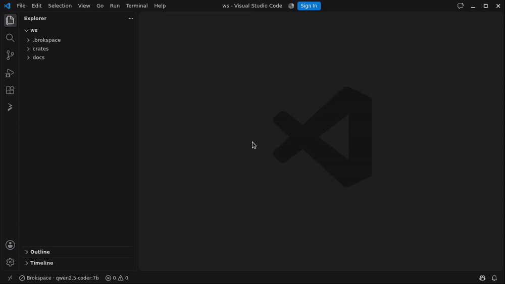

<p align="center">
  
</p>
<p align="center"><b>Brokspace for VS Code: your workspace, understood.</b></p>

Brokspace in the editor you already use. Search every repository in your
folder by meaning, ask questions answered by your own LLM with the sources it
used, review your changes, write commit messages, and keep a memory of
decisions that lasts across sessions and workspaces. Everything runs locally
through [brok](https://github.com/brokspace/brok).

Runs in VS Code 1.90+ and is designed to install in editors based on it (see [Editors](#editors)).
English and Brazilian Portuguese.



_Searching by meaning with `Ctrl+Alt+F`, in the brok repository itself, with text search (no embeddings model)._

## What's inside

|                                  |                                                                                                                                                                                                                                                                           |
| -------------------------------- | ------------------------------------------------------------------------------------------------------------------------------------------------------------------------------------------------------------------------------------------------------------------------- |
| **Search** (`Ctrl+Alt+F`)        | Semantic and keyword search across the workspace and its linked workspaces, as you type.                                                                                                                                                                                  |
| **Chat** (`Ctrl+Shift+Alt+B`)    | The first view of the Brokspace sidebar (or an editor tab: **Open Chat in the Editor**). Questions about the code, answered by your LLM through brok, with the sources. `/review`, `/review staged`, `/skill <name> <task>`. Without an LLM, answers come from the index. |
| **`@brokspace` in Copilot Chat** | The same agent as a chat participant, where the editor has the Chat API.                                                                                                                                                                                                  |
| **Memory** (`Ctrl+Alt+M`)        | Remember a decision, a convention or the selected code; browse, search and forget memories in the sidebar. Chats can be saved as session memories.                                                                                                                        |
| **Linked workspaces**            | Link a local folder or a Git repository (for example the `checkout` service your `user` service calls) and search both.                                                                                                                                                   |
| **Review and commit messages**   | Review the working tree or the staged changes; write the commit message from the Source Control title bar.                                                                                                                                                                |
| **Skills and shards**            | Run skills, install and remove shards, export skills to your agents.                                                                                                                                                                                                      |
| **MCP**                          | Registers brok's MCP server, so Copilot agent mode and other MCP clients get Brokspace search and memory.                                                                                                                                                                 |
| **Settings** (`Ctrl+Alt+,`)      | Model and providers, memory, linked workspaces, metrics, diagnostics and bug reports, in one page.                                                                                                                                                                        |

## Requirements

- [brok](https://brokspace.org/docs/getting-started) 0.4.0 or newer. The extension finds
  it at `brokspace.brokPath`, in `BROK_PATH`, in the usual install locations, or on the `PATH`.
  If it finds none, it offers to download it (see below).
- For answers, reviews and commit messages: an LLM brok can reach (Ollama or
  any OpenAI-compatible provider) and the `brok-agent` shard. **Brokspace:
  Set Up Workspace** walks you through it.

### Download on first use

If brok is not installed, the extension asks before doing anything. Say **Download** and it:

- downloads the `brok` executable for your platform from the
  [brokspace/brok GitHub releases](https://github.com/brokspace/brok/releases) (about 150 to 220 MB; no other host);
- checks it against the SHA-256 published next to it, and installs nothing if it does not match;
- keeps it in the extension's own storage folder: no administrator rights, no change to your `PATH`.

It never replaces a brok you already have: `brokspace.brokPath`, `BROK_PATH`, the usual install folders and
the `PATH` all win over the downloaded copy. Run **Brokspace: Download and Install brok** to do it later, and
remove it by uninstalling the extension. The download is a convenience, not a substitute for your package
manager: `brew install brokspace/brok/brok`, APT or the release binary keep working and update brok on their own.
This is the only network access the extension itself makes; everything else goes through brok.

## Why Brokspace

- **Your LLM, your machine.** Ollama or any OpenAI-compatible provider; nothing is sent anywhere you did not configure.
- **Across repositories.** One search over a folder of several repositories and the ones you link, not one file at a time.
- **Memory that lasts.** Decisions and conventions survive across sessions, and the same index and memory serve your terminal and your coding agents through MCP.
- **Open source.** MIT or Apache-2.0, and no account.

## Getting started

1. Install brok, then this extension.
2. Open a folder and run **Brokspace: Set Up Workspace** from the Brokspace sidebar or
   the Command Palette. It creates `.brokspace/brok.yml`, indexes the folder
   and starts brok.
3. Press `Ctrl+Alt+F` to search, or `Ctrl+Shift+Alt+B` to ask.

The chat walks you through this with a checklist (**Brokspace: Get Started** shows it again). A model is optional: without one, search and answers from the index still work.

Something wrong? **Brokspace: Doctor** shows `brok doctor`, and
**Brokspace: Report a Bug** opens a prefilled GitHub issue with the
diagnostics (secrets masked) in the right repository.

## Settings

| Setting                       | Default |                                                                                                           |
| ----------------------------- | ------- | --------------------------------------------------------------------------------------------------------- |
| `brokspace.brokPath`          | `""`    | Path to the brok executable. Empty: `BROK_PATH`, the install locations, then the `PATH`.                  |
| `brokspace.mcp.enabled`       | `true`  | Register brok's MCP server with the editor. Skipped when `.vscode/mcp.json` already declares `brokspace`. |
| `brokspace.chat.saveSessions` | `true`  | Save chats as session memories (also needs `memory.sessions` in `brok.yml`).                              |
| `brokspace.statusBar.enabled` | `true`  | Show Brokspace's state in the status bar.                                                                 |

Everything else (the model, providers, memory, linked workspaces) lives in
`.brokspace/brok.yml`, so the CLI, the extension and your agents share it.

## FAQ

**Does my code leave my machine?** Not through the extension. Search and memory are local; answers go to the LLM you configured, which can be a local one. The only network access the extension makes itself is the optional brok download.

**Do I need to install anything else?** The `brok` CLI. If it is missing the extension offers to download it, or install it with Homebrew, APT or the release binary.

**It does not find my project.** Run **Brokspace: Set Up Workspace**, then check **Brokspace: Diagnostics**; report problems at [github.com/brokspace/vscode/issues](https://github.com/brokspace/vscode/issues).

## Editors

Visual Studio Code is the supported and tested editor. The extension uses only the public extension API
(`engines.vscode` is `^1.90.0`), so it is designed to install in editors based on VS Code, such as Cursor,
Windsurf, Devin Desktop and VSCodium. That is a design goal, not a guarantee: we test in VS Code only, and a
feature that needs an API a fork lacks (the `@brokspace` chat participant, MCP registration) is turned off
while the rest keeps working. The Visual Studio Marketplace serves Microsoft's products; editors that use
[Open VSX](https://open-vsx.org/extension/brokspace/brokspace) (Cursor, Windsurf, VSCodium and others) can install
`brokspace.brokspace` from their extensions view. Otherwise install the `.vsix` from the
[GitHub releases](https://github.com/brokspace/vscode/releases) with **Extensions: Install from VSIX**. Please
report problems with the editor and its version.

## Development

You need Node.js 24 and VS Code 1.90 or newer. brok (0.4.0 or newer) is optional for most work; the contract
and integration tests use it when `BROK_TEST_PATH` points at a binary.

```sh
git clone https://github.com/brokspace/vscode && cd vscode
git switch staging         # the reference branch; open PRs against it
npm ci
```

### Run it

Open the folder in VS Code and press `F5` (**Run Extension**). A second window, the Extension Development
Host, opens with the extension loaded; open a project folder in it and run **Brokspace: Set Up Workspace**.
`npm run watch` rebuilds on save; reload the host window (`Ctrl+R`) to pick up changes.

To try it like a user would, build the package and install it into a throwaway profile, leaving your own
editor untouched:

```sh
npm run package            # brokspace-<version>.vsix
code --user-data-dir /tmp/brok-ud --extensions-dir /tmp/brok-ext --install-extension brokspace-*.vsix
code --user-data-dir /tmp/brok-ud --extensions-dir /tmp/brok-ext <a project folder>
```

### Validate it

Run what CI runs before every push:

```sh
npm run lint && npm run typecheck && npm run l10n:check && npm run test:unit
```

| Command                    | What it checks                                                                                                                                                                          |
| -------------------------- | --------------------------------------------------------------------------------------------------------------------------------------------------------------------------------------- |
| `npm run test:unit`        | Pure logic with `node:test`: brok's JSON, the downloader, search, formatting. Fast, no editor.                                                                                          |
| `npm run test:integration` | The extension inside a downloaded VS Code (needs a display; use `xvfb-run` on a headless Linux). Set `BROK_TEST_PATH=/path/to/brok` to also run the test that sets up a real workspace. |
| `npm run l10n:check`       | Every user-visible string has a Portuguese translation (`npm run l10n:check -- --write` extracts new ones).                                                                             |

New or changed strings go through `vscode.l10n.t('...')` on one line, in single quotes, without
apostrophes: the extraction reads them literally.

By hand, before a release, in a profile that has no `brok` on its `PATH` (for example
`PATH=/usr/bin:/bin code ...`): the first-use prompt should appear, **Download** should show progress and end
with a working status bar, and **Cancel** should leave nothing behind. With a `brok` installed, none of that
should appear and the extension must use yours.

Releases: the Promote workflow opens the `staging` to `main` PR; after it merges, tag `vX.Y.Z` (matching
`package.json`) on `main` and the Release workflow packages, attaches the VSIX and publishes. Setup of the
publishing accounts is in the brok repository, `docs/publishing.md`.

Contributor and agent guide: [AGENTS.md](AGENTS.md). UI tokens, components and accessibility rules: [docs/design-system.md](docs/design-system.md).

## License

MIT or Apache-2.0, at your option.
